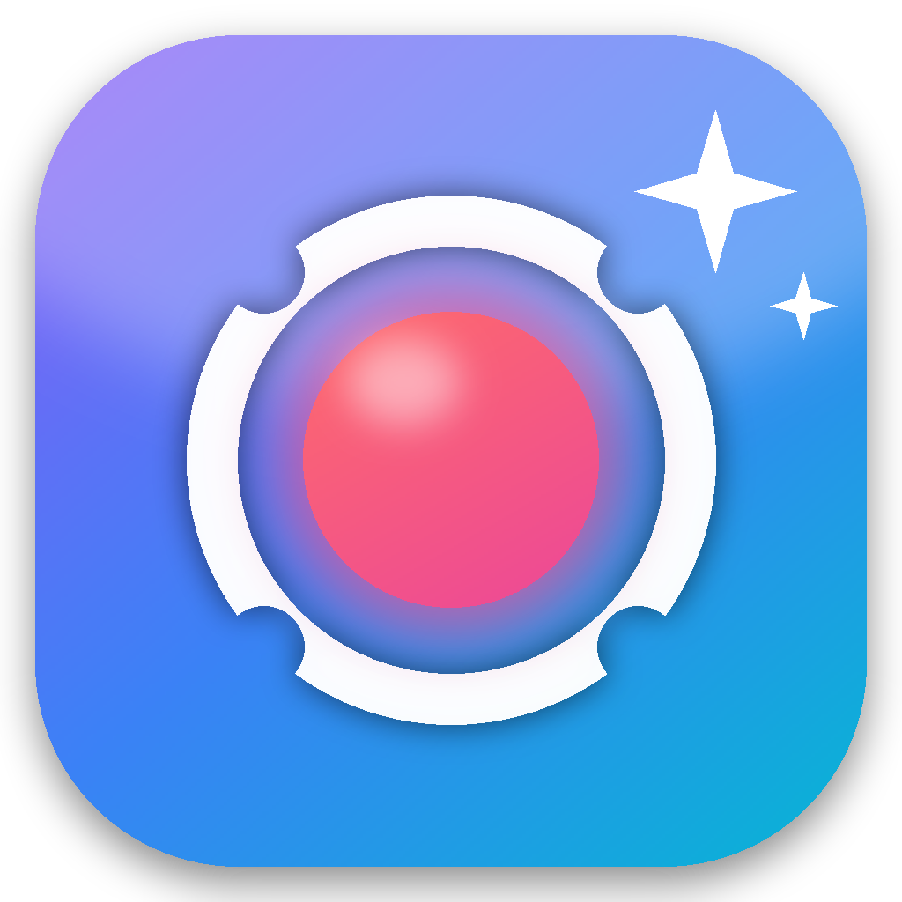

  

<h1 align="center">Chroma Studio</h1>

  A colourful, professional screen recorder for Windows — video, screenshots, webcam, annotations. 
  <b>Windows 7 SP1 · 8 · 8.1 · 10 · 11</b>

  
  
  

---

## ⬇️ Download

Get the newest version from **[Releases → Latest](https://github.com/fodarexmon/ChromaStudio-Updates/releases/latest)**:

| File | Use it when |
|---|---|
| `ChromaStudio-x.y.z-setup.exe` | **Recommended.** Installer, includes FFmpeg, adds a Start menu entry |
| `ChromaStudio-x.y.z-win-full.zip` | Portable, includes FFmpeg |
| `ChromaStudio-x.y.z-win-portable.zip` | Portable, bring your own FFmpeg |
| `SHA256SUMS.txt` | Checksums to verify the downloads |

**Requirement:** .NET Framework 4.8 — already built into Windows 10 and 11
([free download](https://dotnet.microsoft.com/download/dotnet-framework/net48) for Windows 7 SP1 / 8.1).

Already installed? You don't need to come back here: Chroma Studio tells you when a new version is out and
updates itself in one click (download, checksum check, silent install, restart).

## Highlights

- Full screen, region or window recording — window recordings follow the window
- **Zero-copy GPU pipeline**: 4K at 60 fps using NVIDIA NVENC, Intel Quick Sync or AMD AMF
- System audio + microphone with automatic sync correction
- Webcam bubble, click highlights, draw on screen while recording
- Screenshots, trim editor, library with thumbnails
- System tray, floating quick widget, global shortcuts
- English and Arabic (right-to-left) interface, six colour themes

## Shortcuts

| Shortcut | Action |
|---|---|
| `Ctrl+Shift+R` | Start / stop recording |
| `Ctrl+Shift+P` | Pause / resume |
| `Ctrl+Shift+S` | Region screenshot |
| `Ctrl+Shift+F` | Full-screen screenshot |
| `Ctrl+Shift+D` | Draw on screen |
| `Ctrl+Shift+W` | Show / hide the widget |

## Found a bug?

[Open an issue](https://github.com/fodarexmon/ChromaStudio-Updates/issues/new/choose) and attach the log
(**Settings → About → Open log folder**). The app's crash dialog has a *Report on GitHub* button that brings you here.

## About this repository

This repository only publishes official release builds; releases are copied here automatically by the
project's build pipeline. Chroma Studio is MIT-licensed — see [LICENSE](LICENSE). The *setup* and *full*
packages include an unmodified GPL build of FFmpeg, run as a separate program — see
[THIRD-PARTY-NOTICES.md](THIRD-PARTY-NOTICES.md).

---

## بالعربية

**Chroma Studio** برنامج احترافي وملوّن لتسجيل الشاشة على Windows من 7 حتى 11: فيديو، ولقطات شاشة، وكاميرا ويب، ورسم على الشاشة.

**التنزيل:** من صفحة [أحدث إصدار](https://github.com/fodarexmon/ChromaStudio-Updates/releases/latest). الملف الموصى به هو `ChromaStudio-x.y.z-setup.exe`، وفيه FFmpeg.
المتطلب الوحيد ‎.NET Framework 4.8، وهو موجود مسبقاً في Windows 10 و 11.

لو كان البرنامج مثبتاً عندك فلا تحتاج العودة لهذه الصفحة: يخبرك البرنامج بالإصدار الجديد ويحدّث نفسه بنقرة واحدة.

**لو وجدت مشكلة:** [افتح بلاغاً](https://github.com/fodarexmon/ChromaStudio-Updates/issues/new/choose)، وأرفق ملف السجل من الإعدادات ← حول البرنامج ← فتح مجلد السجلات.

